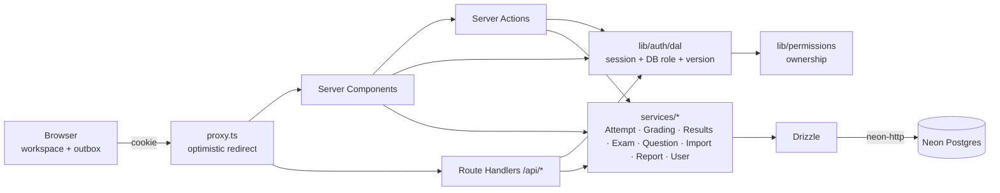

# CodeKaizen Exams: Secure Examination Management System

TechnoVerse 5.0 Web-e-Thon · innovation track **5.3 Failure-Resilient Examinations**

**Live:** https://code-kaizen-taupe.vercel.app · **Repo:** https://github.com/riazaslam029/codeKaizen

CodeKaizen Exams is a Next.js modular monolith for authoring, delivering, monitoring, grading and publishing examinations. It has three roles, and the server enforces each one: **Admin**, **Examiner** and **Candidate**. A candidate can lose their connection, refresh the page or close the tab during an exam without losing answers or gaining extra time. Everything that happens is recorded where an examiner can review it.

---

## Demo accounts

**Password for every demo account: `12345678`**

| Role | Email | Password | What it shows |
| --- | --- | --- | --- |
| Admin | `admin@codekaizen.test` | `12345678` | users, roles, restriction, platform activity |
| Examiner (owns all demo exams) | `d.reyes@codekaizen.test` | `12345678` | authoring, monitoring, grading, publishing, analytics |
| Examiner (owns nothing) | `p.nair@codekaizen.test` | `12345678` | ownership isolation (sees no exams) |
| Candidate with history | `lena.fischer@codekaizen.test` | `12345678` | results, trend chart, disruption log, practice exam |
| Candidates | `omar.haddad@` · `sofia.marin@` · `mei.tanaka@` · `jonas.berg@` · `aisha.bello@codekaizen.test` | `12345678` | varied scores and events |
| **Restricted** candidate | `ravi.kumar@codekaizen.test` | `12345678` | correct password still gets *“Your account has been restricted…”* |

These are demo-only accounts with no real data. On a deployment where `DEMO_LOGIN_PASSWORD` is set, the login page also shows **quick-fill** buttons for each role.

### Seeded story (development branch, `npm run db:seed`)
| Exam | State | Why it is there |
| --- | --- | --- |
| `WSEC-PRACTICE` | open for 30 days, 3 attempts allowed | start an exam at any time during the demo |
| `WSEC-FINAL` | opens in 3 days (moved forward on every re-seed) | candidate "Next examination" countdown |
| `WSEC-SESS` | closed 2 days ago, **not published**, essays ungraded | publish checklist blocks until grading is done |
| `WSEC-MID` | closed 10 days ago, **published** | connection loss and reconnect, reload recovery, sync failure, auto-submit; analytics |
| `WSEC-DIAG` | closed 24 days ago, **published** | second data point for each candidate's performance trend |
| `WSEC-101` | 11-question reference exam | question bank source |

---

## 5.3 Failure-resilient examinations

| Failure | What happens | Where it is enforced |
| --- | --- | --- |
| **Wi-Fi drops mid-exam** | Answers go into a local outbox (localStorage) and the pill turns *Offline*. A banner says: *“Your answers are safe… The server timer keeps running.”* Each answer shows *Saved on this device, will sync*. | `use-answer-sync.ts` |
| **Connection returns** | The outbox flushes with exponential back-off. The pill goes *Reconnecting* → *Online*. `NETWORK_LOSS` / `RECONNECTED` (offline seconds) are recorded. | `/api/attempts/[id]/answers`, `/events` |
| **Flaky network** | The pill shows *Unstable* with a retry countdown and a *Retry now* button. After 3 failures a `SYNC_FAILED` incident is recorded. | client back-off, incidents table |
| **Retries / out-of-order delivery** | Every save carries a per-question **revision**. The server writes only if `revision > stored`, so retries are idempotent and an old save can never overwrite a newer one. | `onConflictDoUpdate … setWhere` |
| **Refresh, crash, new tab** | The server sees a new client session id. It records `ATTEMPT_RESUMED` and the workspace shows *“Attempt restored — no time was added”*. | `AttemptService.getState` |
| **Clock tampering** | The deadline is `expiresAt` in the database. The browser timer is only a display synced to server time on every response. | `computeExpiry`, `serverNow` |
| **Answers after the deadline** | Rejected after a 3-second network grace, and `LATE_ANSWER_REJECTED` is recorded. | `saveAnswers` |
| **Candidate never comes back** | The attempt is finalised as `AUTO_SUBMITTED` the next time anyone reads it (lazy finalisation). Saved answers are graded. | `finalizeExpired` |
| **Double-click / repeated submit** | A conditional `UPDATE … WHERE status='IN_PROGRESS'`: only the first submit wins. Repeats are recorded as `DUPLICATE_SUBMISSION`. | `AttemptService.submit` |
| **Two starts at once** | A partial unique index allows only one open attempt per candidate per exam. | `attempts_one_open_uq` |
| **Question bank edited mid-exam** | Questions and the marking scheme are frozen into `question_snapshot` at start. | attempts table |

The examiner **Monitoring** page shows these events separately from **integrity indicators**, with the note *“Indicators are not evidence of misconduct.”* Candidates see their own connection and recovery log in the workspace.

## Account restriction (admin)

- The admin clicks **Restrict** and confirms. This sets `is_active=false` and bumps `session_version`, which invalidates every existing token at once.
- The candidate's next request returns **403 `ACCOUNT_RESTRICTED`**. The client interceptor, a 45-second poll and the window-focus check all show a modal, then send the candidate to the login page.
- The login form checks the password first. Only with a correct password does it show *“Your account has been restricted by an administrator. Contact your institution.”* A wrong password stays a generic 401.
- An open attempt is **preserved**: the timer keeps running on the server, `ACCESS_RESTRICTED` / `ACCESS_RESTORED` appear in its timeline, and restoring access lets the candidate resume.
- Admins cannot restrict themselves or the last active admin. Every change is audited.

---

## Feature map

**Admin:** users (create, edit, restrict or restore, reset password), roles and permissions matrix, platform activity with filters, dashboard with a 14-day activity chart.

**Examiner:**
- **Exams:** exam CRUD with a lifecycle (Draft → Published → Ongoing → Completed → Archived). The question bank covers single-answer, multi-select (all-or-nothing or partial), true/false, short-answer and essay questions, with subject, topic, difficulty and negative marks.
- **Setup:** assign questions to an exam, shuffle questions and options, set the window, duration and attempt limits. Enrol candidates individually or in bulk. Sandbox preview never counts towards results.
- **During the exam:** announcements and live monitoring.
- **After the exam:** manual grading, then publish, unpublish or override with a checklist. Question analytics cover skip rate, most common wrong answers and difficulty against accuracy. Exam PDF report.

**Candidate:** dashboard with a countdown to the next exam and a performance trend. My examinations (available, upcoming, completed, with instructions and eligibility).

The exam workspace has:
- question navigator, mark for review, review screen, Save & exit
- scratchpad, preferences (font size, layout, light, dark or high contrast)
- keyboard shortcuts (`N`/`P`/`1–9`/`F`/`?`)

Candidates see a result only once it is published. A published result shows a score gauge, per-topic breakdown, question review and time spent, plus a PDF with a QR code. Anyone can check that PDF on the public `/verify/<code>` page, which shows the exam, issue date and whether it is valid, invalid or revoked. It never shows marks or the candidate's name.

**Bulk import:** CSV or JSON for questions and candidates. A dry-run preview shows a row/field/reason error table and skips duplicates. You can import only the valid rows. Ready-made files are in [`sample-data/`](sample-data/README.md); the 100-question set imports cleanly.

**UI:** light, dark or system theme with no flash on load. The sidebar is grouped and collapsible, and the top bar has breadcrumbs, a Ctrl+K command palette and notifications. Accessibility tests check WCAG 2.1 AA in both themes, plus 44 px touch targets, a skip link and reduced-motion support.

---

## Stack

| Layer | Choice | Why |
| --- | --- | --- |
| App | Next.js 16 (App Router, Cache Components), React 19, TypeScript | one deployable; data access stays on the server |
| UI | Tailwind CSS 4, shadcn/ui (Radix), lucide, Sonner, Recharts, next-themes | accessible primitives, design tokens, charts from real data |
| DB | Neon PostgreSQL + Drizzle ORM (`neon-http`) | `db.batch` = atomic transaction over HTTPS |
| Auth | bcryptjs + jose (HS256 JWT, HTTP-only cookie, `session_version`) | role and active flag re-read from the DB on every request |
| Reports | pdf-lib + qrcode | generated on the server; no external or paid service |
| Validation | Zod 4 (client + server) | |



**Database (14 tables):**
- `users`, `exams`, `questions`, `exam_questions`, `enrollments`
- `attempts`, `answers`, `results`
- `announcements`, `incidents`, `disputes`
- `user_preferences`, `scratchpads`, `audit_logs`

The schema uses UUID keys, Postgres enums and CHECK constraints for windows, marks and percentages. It also has case-insensitive unique email, a unique exam code, unique exam+candidate and attempt+question pairs, and the partial unique index for open attempts. Migrations are in `drizzle/`.

**Security:**
- Every page, route handler and server action re-authorises through the DAL.
- Examiners only manage their own exams. Candidates only see their own attempts and results; anything else returns 404.
- Answer keys never reach the client (`toCandidateQuestions` allow-list).
- Input validation errors return 400 with field details.
- Results are published only by an explicit examiner action.

---

## Setup

```bash
npm install
neon env pull --branch dev -s postgres          # .env.local → Neon dev branch
# add AUTH_SECRET and SEED_*_PASSWORD to .env.local (see .env.example)
npm run db:migrate                              # dev branch
npm run db:seed                                 # dev only; refuses on production
npm run dev                                     # http://localhost:3000
```

There are two Neon branches: **production** (live) and **dev** (local work, demo data, tests). Production migrations are additive and recorded. Run `npm run db:status:prod`, review the output, then run `npm run db:migrate:prod` before promoting a deploy.

| Command | Purpose |
| --- | --- |
| `npm run typecheck` · `lint` · `build` | static checks and production build |
| `npm test` | unit tests (Vitest) |
| `npm run test:integration` | services against the Neon **dev** branch |
| `npm run test:e2e` | builds and drives the app in Chrome: journeys, restriction, import, offline recovery, axe in light and dark, responsive |
| `npm run db:seed` | demo data (dev only) |

See [tests/README.md](tests/README.md), [DEMO_SCRIPT.md](DEMO_SCRIPT.md), [REQUIREMENTS.md](REQUIREMENTS.md) and [UI_AUDIT.md](UI_AUDIT.md).

## Deployment (Vercel)
Production needs `DATABASE_URL` (pooled production branch) and a unique `AUTH_SECRET`. `DEMO_LOGIN_PASSWORD` is optional and enables the login quick-fill buttons. Never set `SEED_*` on Vercel.
