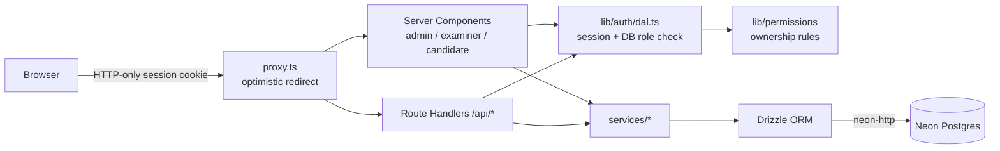

# CodeKaizen — Secure Examination Management System

TechnoVerse 5.0 Web-e-Thon. A modular-monolith Next.js app for authoring, delivering, proctoring and grading examinations with three server-enforced roles: **Admin**, **Examiner**, **Candidate**.

## Stack

| Layer | Choice | Why |
| --- | --- | --- |
| App | Next.js 16 (App Router, Cache Components), React 19, TypeScript | One deployable on Vercel; server components keep data access on the server |
| UI | Tailwind CSS 4, shadcn/ui (Radix), Lucide, Sonner, Recharts | Accessible primitives, consistent tokens |
| DB | Neon PostgreSQL + Drizzle ORM over `@neondatabase/serverless` (HTTP driver) | One HTTPS round-trip per query, no pool to manage in serverless functions |
| Auth | bcryptjs (cost 12) + jose HS256 JWT in an HTTP-only cookie | No third-party auth dependency; role re-read from DB on every request |
| Validation | Zod (shared client + server schemas) | |

## Architecture



```
src/
  app/(auth)/login        sign-in page + client form
  app/{admin,examiner,candidate}  role areas (shared AppShell layout)
  app/api/                auth, health, users, candidates
  components/{ui,layout,shared}
  db/schema/              enums, tables, relations, JSON types
  lib/auth/               password, token, session, dal (data access layer)
  lib/permissions/        reusable authorization rules
  lib/validations/        Zod schemas
  services/               business logic (UserService, ExamService, candidate-safe views)
  proxy.ts                optimistic route protection (Next 16 replacement for middleware)
drizzle/                  SQL migrations
scripts/                  migrate, seed (dev only), smoke-test
```

### Security model
- Passwords hashed with bcrypt; unknown emails are checked against a dummy hash so timing does not reveal which accounts exist.
- Session = signed JWT (issuer, audience, 8 h expiry) in an `HttpOnly; SameSite=Lax` cookie, `Secure` in production.
- `proxy.ts` only redirects. **Every page and route handler re-authorizes** via `requireRole()` / `authorize()`, which reload the user from the DB, so a role change or deactivation applies immediately.
- Only admins change roles, and never their own (`assertCanChangeRole`).
- Candidate records: candidates see only their own; examiners only candidates in exams they own; others get **404** (existence is not leaked).
- Attempts store a frozen `question_snapshot` (questions + marking scheme). Candidates only ever receive `toCandidateQuestions()`, an explicit allow-list that omits answer keys.

### Database (11 tables)
`users`, `exams`, `questions` (bank), `exam_questions` (ordered M:N), `enrollments`, `attempts` (frozen snapshot), `answers`, `results`, `announcements`, `incidents`, `disputes`. UUID keys, `created_at`/`updated_at`, Postgres enums for roles/statuses, CHECK constraints (exam window, marks > 0, percentages 0–100), unique keys (case-insensitive email, exam code, exam+candidate, attempt+question), indexes on every FK and hot filter. `ON DELETE CASCADE` only for owned children (exam → exam_questions/enrollments, attempt → answers/incidents); `RESTRICT` where history must survive (attempts, results, question authorship).

## Setup

```bash
npm install
# Neon (already linked for this repo): writes DATABASE_URL + DATABASE_URL_UNPOOLED into .env.local
neon env pull
# Add AUTH_SECRET and SEED_* passwords to .env.local (see .env.example)
npm run db:migrate     # applies drizzle/*.sql over the direct (unpooled) endpoint
npm run db:seed        # dev only: 1 admin, 2 examiners, 3 candidates, exam WSEC-101 with 11 questions
npm run dev
```

Demo accounts (dev seed; passwords are the `SEED_*` values in your `.env.local`):

| Role | Email |
| --- | --- |
| Admin | admin@codekaizen.test |
| Examiner (owns WSEC-101) | d.reyes@codekaizen.test |
| Examiner (no exams) | p.nair@codekaizen.test |
| Candidate (enrolled) | lena.fischer@codekaizen.test, omar.haddad@codekaizen.test |
| Candidate (not enrolled) | sofia.marin@codekaizen.test |

## Scripts
| Command | Purpose |
| --- | --- |
| `npm run typecheck` / `npm run lint` | static checks |
| `npm run build` | production build |
| `npm run db:generate` | generate a migration after editing `src/db/schema` |
| `npm run db:migrate` | apply migrations |
| `npm run db:seed` | development seed (refuses in production) |
| `npm run test:smoke` | 29 end-to-end auth/authorization checks against a running server (`BASE_URL`, default `http://localhost:3000`) |

## Deployment (Vercel)
Set `DATABASE_URL` (pooled), `DATABASE_URL_UNPOOLED` and `AUTH_SECRET` in the Vercel project. Run `npm run db:migrate` against production before or during deploy. Never set `SEED_*` in production.
