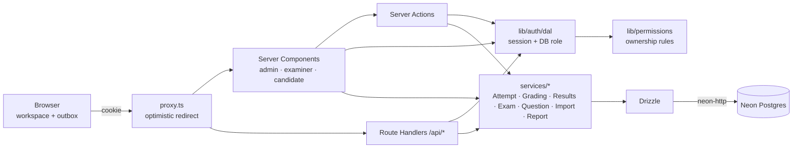

# CodeKaizen — Secure Examination Management System

TechnoVerse 5.0 Web-e-Thon. A modular-monolith Next.js application for authoring, delivering, monitoring, grading and publishing examinations, with three server-enforced roles: **Admin**, **Examiner**, **Candidate**.

**Primary innovation — failure-resilient examinations:** server-authoritative timing, revisioned idempotent autosave with an offline outbox, recovery after refresh/reconnect (no extra time), duplicate-submission protection, automatic finalisation at the server deadline, and a transparent incident trail for examiners.

## Stack

| Layer | Choice | Why |
| --- | --- | --- |
| App | Next.js 16 (App Router, Cache Components), React 19, TypeScript | One deployable on Vercel; server components keep data access on the server |
| UI | Tailwind CSS 4, shadcn/ui (Radix), Lucide, Sonner, Recharts | Accessible primitives, consistent tokens, real-data charts |
| DB | Neon PostgreSQL + Drizzle ORM over `@neondatabase/serverless` (HTTP) | One HTTPS round-trip per query; `db.batch` = atomic transaction |
| Auth | bcryptjs + jose (HS256 JWT in HTTP-only cookie) | Role re-read from DB on every request |
| Reports | pdf-lib | Real PDF generation, no external service |
| Validation | Zod (shared by client and server) | |

## Architecture



```
src/app/(auth)/login · admin/* · examiner/* · candidate/* · attempt/[id] (workspace) · verify/* · api/*
src/services/  attempts · grading · results · exams · questions · import · reports · users · audit · preferences
src/lib/       auth (password, token, session, dal) · permissions · validations · scoring · csv · exam-phase
src/db/schema  enums · tables · relations · json types        drizzle/  SQL migrations
scripts/       migrate · seed (dev only) · smoke-test · e2e-exam-flow
```

### Database (14 tables)
`users`, `exams`, `questions`, `exam_questions`, `enrollments`, `attempts` (frozen `question_snapshot`, `is_sandbox`, `last_seen_at`, `client_session_id`), `answers` (`revision` for idempotent saves), `results` (`verification_code`), `announcements`, `incidents`, `disputes`, `user_preferences`, `scratchpads`, `audit_logs`.
UUID keys, timestamps, Postgres enums, CHECK constraints (window, marks, percentages), unique keys (case-insensitive email, exam code, exam+candidate, attempt+question, attempt number) and a **partial unique index allowing only one open attempt per candidate per exam**.

### Security decisions
- Every page, route handler and server action re-authorises via the DAL (DB role, `isActive`); `proxy.ts` only redirects.
- Ownership: examiners manage only their exams; candidates only their own attempts/results (others get **404**).
- Answer keys never leave the server: candidates receive `toCandidateQuestions()` (explicit allow-list).
- Admins cannot change their own role or deactivate themselves; deactivation ends live sessions immediately.
- Results are published only by an explicit examiner action; published grades are locked.
- Public verification shows only masked name, exam, outcome, percentage and date.

## Setup

Two Neon branches: **`production`** (live data) and **`dev`** (copy of production for local work, demo accounts, tests).

```bash
npm install
neon env pull --branch dev -s postgres                                          # .env.local → dev branch
neon env pull --branch production -s postgres --file .env.neon.production       # production strings, kept separate
# add AUTH_SECRET and SEED_* passwords to .env.local (see .env.example)
npm run db:status        # dev: connectivity + migration status
npm run db:migrate       # dev: apply pending migrations
npm run db:seed          # dev only — refuses on the production branch
npm run dev
```

Production migrations (additive, recorded, re-runnable): `npm run db:status:prod` → review → `npm run db:migrate:prod`.

| Role | Demo account on the **dev** branch (password = your `SEED_*` value) |
| --- | --- |
| Admin | admin@codekaizen.test |
| Examiner (owns both exams) | d.reyes@codekaizen.test |
| Examiner (no exams) | p.nair@codekaizen.test |
| Candidates | lena.fischer@ · omar.haddad@ · sofia.marin@codekaizen.test |

## Scripts

| Command | Purpose |
| --- | --- |
| `npm run typecheck` / `npm run lint` / `npm run build` | static checks and production build |
| `npm run db:generate` | create a migration after editing `src/db/schema` (no DB access) |
| `npm run db:migrate` / `db:status` | apply / inspect migrations on **dev** |
| `npm run db:migrate:prod` / `db:status:prod` | apply / inspect migrations on **production** (explicit) |
| `npm run db:seed` | demo data, **dev branch only** |
| `npm test` | unit tests (Vitest) |
| `npm run test:integration` | services against the Neon **dev** branch (Vitest) |
| `npm run test:e2e` | builds, starts and drives the app in Chrome: journeys, security, accessibility, responsive, offline (Playwright) |
| `npm run test:coverage` | unit + integration with v8 coverage → `coverage/index.html` |

See [tests/README.md](tests/README.md) for what each suite covers and how test data is isolated.

## Deployment (Vercel)
Production env: `DATABASE_URL` (production pooled) and `AUTH_SECRET` (unique). Preview env may point at the `dev` branch. Migrate with `npm run db:migrate:prod` before promoting a deploy. Never set `SEED_*` on Vercel.
